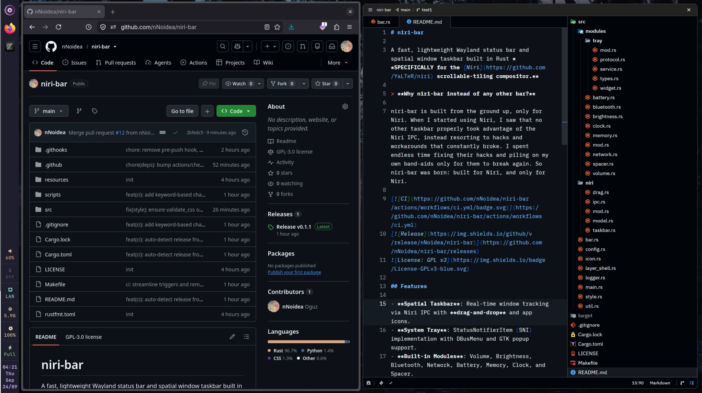
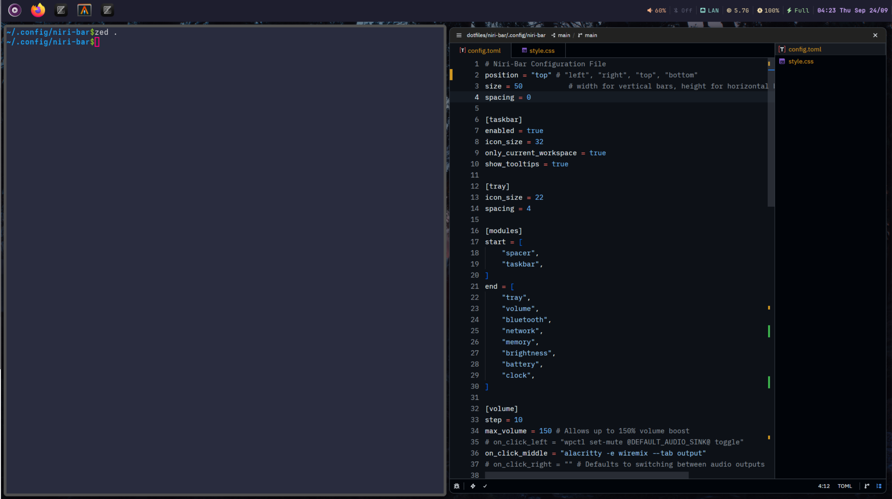

<div align="center">
  
</div>

# niri-bar

A fast, lightweight Wayland taskbar built in Rust **SPECIFICALLY for the [Niri](https://github.com/YaLTeR/niri) scrollable-tiling compositor.**

> **Why `niri-bar` instead of any other bar?**

`niri-bar` is built from the ground up, only for Niri. When I started using Niri, I saw that no other taskbar properly took advantage of the Niri IPC, instead resorting to hacks and workarounds that constantly broke. I spent endless time fixing their hacks and piling on my own band-aids only for them to break again. So `niri-bar` was born: built for Niri, and only for Niri.

# Screenshots & Video

https://github.com/user-attachments/assets/da22fb12-8062-4617-a743-598555fd0e36




[](https://github.com/nNoidea/niri-bar/actions/workflows/ci.yml)
[](https://github.com/nNoidea/niri-bar/releases)


## Features

- **Spatial Taskbar**: Real-time window tracking via Niri IPC with drag-and-drop reordering and app icons for within and across monitors.
- **System Tray**: StatusNotifierItem (SNI) implementation with DBusMenu and GTK popup support.
- **Built-in Modules**: Volume, Brightness, Bluetooth, Network, Battery, Memory, Clock, Spacer, ...
- **Display Awareness**: Automatic multi-monitor reconciliation and layer-shell integration.
- **Customizable**: TOML configuration and GTK CSS styling with horizontal and vertical layout support.
- **Lightweight**: Deliberately built with GTK3 and pure Rust to keep resource usage as low as possible.
- **Hot Reloading**: Instantly applies configuration and CSS changes on save without restarting.

## Installation

### Binary

Download the binary from [Releases](https://github.com/nNoidea/niri-bar/releases/latest) and place it in your `PATH` (e.g. `~/.cargo/bin` or `/usr/local/bin`).

### Build

Default installation installs to `~/.cargo/bin/niri-bar`.

```bash
git clone https://github.com/nNoidea/niri-bar.git
cd niri-bar
make install
```

Or install directly with Cargo:

```bash
cargo install --git https://github.com/nNoidea/niri-bar
```

### Requirements

#### Runtime

```
Niri
gtk3
gtk-layer-shell
wpctl / pw-mon (volume module)
bluetoothctl (bluetooth module)
brightnessctl (brightness module)
```

#### Build (Extra needs)

```
rust
gcc / clang
pkg-config
make
```

## Usage

Add `niri-bar` to your Niri configuration (`~/.config/niri/config.kdl`):

```kdl
spawn-at-startup "niri-bar"
```

## Configuration

On first launch, default configuration and stylesheet templates are created at:

- `~/.config/niri-bar/config.toml`
- `~/.config/niri-bar/style.css`

For reference on available configuration options and CSS classes, see:

- [`resources/config.default.toml`](resources/config.default.toml)
- [`resources/style.default.css`](resources/style.default.css)

## License

GPL-3.0-or-later. See [LICENSE](LICENSE) for details.
